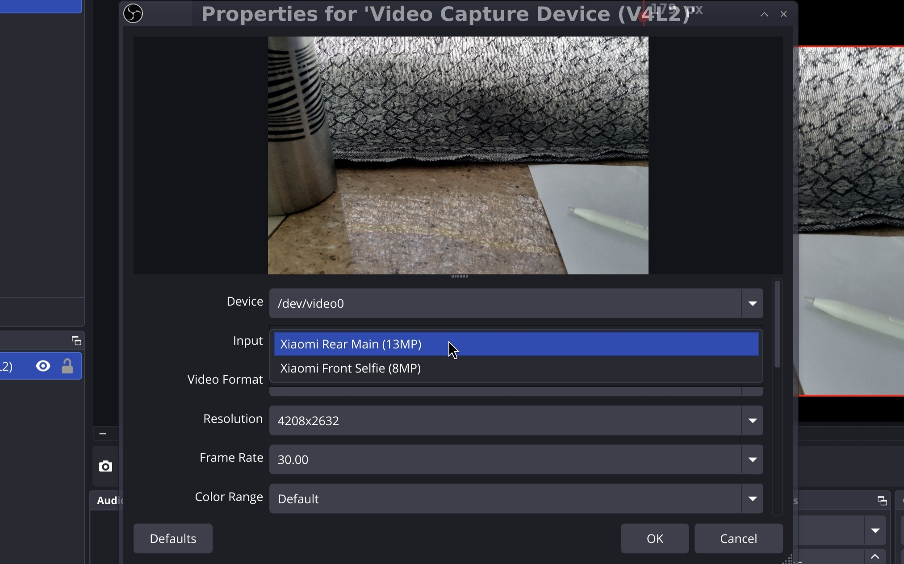
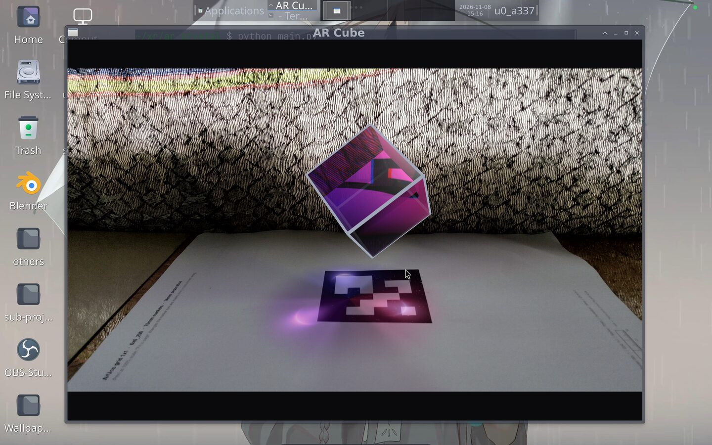
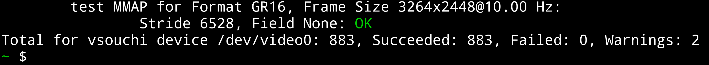

<div align="center">
  

  <h1>vSōchi</h1>

  <p><strong>Rootless Virtual Device Nodes for Linux on Android</strong></p>

  <p>
    <a href="#getting-started"></a>
    <a href="#features--scope"></a>
    <a href="./LICENSE"></a>
  </p>

  <p>
    <a href="#preview">Preview</a> &bull;
    <a href="#features--scope">Features</a> &bull;
    <a href="#getting-started">Getting Started</a> &bull;
    <a href="#architecture">Architecture</a> &bull;
    <a href="#configuration">Configuration</a> &bull;
    <a href="#development">Development</a>
  </p>
</div>

---

## Overview

**vSouchi** is a userspace compatibility layer that exposes Android hardware and platform services as standard Linux character devices (`/dev/*`) and sysfs topologies (`/sys/*`) for Linux-on-Android environments (such as Termux, PRoot, or containerized chroots).

This project focuses on _V4L2 video capture_ as its primary subsystem, with architectural support designed to extend into a generalized node interception framework.

_vSouchi_ aims to remain unprivileged and purely in userspace by emulating virtual device nodes on top of standard public Android APIs and platform services.

---

## Preview

<table>
  <tr>
    <td width="50%" align="center">
      <a href=".github/assets/screenshots/obs-studio.jpg">
        
      </a>
    </td>
    <td width="50%" align="center">
      <a href=".github/assets/screenshots/opencv.jpg">
        
      </a>
    </td>
  </tr>
  <tr>
    <td colspan="2" align="center">
      <em>Live <code>/dev/video0</code> capture from OBS Studio and OpenCV running in Termux + Termux-X11 (XFCE) without root</em>
    </td>
  </tr>
</table>

<table>
  <tr>
    <td align="center">
      <a href=".github/assets/screenshots/v4l2-compliance.png">
        
      </a>
    </td>
  </tr>
  <tr>
    <td align="center">
      <em>Results of <code>v4l2-compliance</code> tests across all available inputs, resolutions, and pixel formats</em>
    </td>
  </tr>
</table>

---

## Features & Scope

- **v1.0.0: Rootless Virtual V4L2 Node (/dev/video0)**
  - [x] Basic sysfs emulation (`/sys/class/video4linux/video0`)
  - [x] Standard YUV formats via libyuv conversion (NV12, YUYV, etc.)
  - [x] Raw and compressed format passthrough mapped to hardware support (MJPG, Bayer)
  - [x] Writable user controls for HFLIP, VFLIP, and ROTATE
  - [x] Multi-input camera switching on a single node (Rear/Front)
  - [x] Termux PRoot and glibc environment support
  - [x] Zero-failure pass on `v4l2-compliance` test suite
- **v1.0.0..v2.0.0:**
  - [ ] **Phase 1:** Extend Device Node Framework for Multi-Node Management
  - [ ] **Phase 2:** Remaining V4L2 User Controls and Userspace v4l2loopback ABI Support
- **v2.0.0..v3.0.0:** Rootless Virtual ALSA Node (`/dev/snd/*`)
- **v3.0.0+:** *TBD*

---

## Getting Started

Install the `vSouchi` APK from the [latest release](https://github.com/lumaparallax/vsouchi/releases/latest).
> Requires Android 8 or later

### For Termux

Download the release tarball:

(These commands assume an aarch64/arm64 architecture. Change it to x86_64 for your system if necessary.)

```bash
curl -fLO https://github.com/lumaparallax/vsouchi/releases/latest/download/vsouchi-aarch64.tar.gz
```

Extract the tarball into `~/.vsouchi` directory:

```bash
mkdir -p $HOME/.vsouchi
tar -xf vsouchi-aarch64.tar.gz -C $HOME/.vsouchi
```

Launch `vsouchi.sh` from Termux:

```bash
$HOME/.vsouchi/vsouchi.sh > /dev/null 2>&1 &
```

The vSouchi app will request the required permissions on its first run. If the prompt does not appear, grant them manually in Android App Info / Settings.

**Test:**

This requires the `v4l-utils` package to be installed from the Termux root-package repository.

```bash
LD_PRELOAD=$HOME/.vsouchi/libvsouchi.so v4l2-ctl --all
```

Or run GUI-based tests using FFmpeg, FFplay, or Firefox. Example:

```bash
LD_PRELOAD=$HOME/.vsouchi/libvsouchi.so ffplay -f v4l2 -i /dev/video0 -video_size 640x480
```

**Terminate vSouchi:**

vSouchi will auto-terminate when you exit Termux. To manually stop it:

```bash
pkill -f vsouchi
```


To avoid typing `LD_PRELOAD` before every command, export the shim in your `~/.bashrc` (you still need to launch `vsouchi.sh` manually):


```bash
export LD_PRELOAD="$HOME/.vsouchi/libvsouchi.so${LD_PRELOAD:+:$LD_PRELOAD}"
```

> If you experience frame stalls or background freezes, disable battery optimizations for vSouchi app in Android Settings.

### For PRoot

Follow the Termux setup steps above and start `vsouchi.sh`, then copy the glibc shim into Termux tmp directory:

```bash
cp $HOME/.vsouchi/libvsouchi-glibc.so $TMPDIR
```

Launch your `proot-distro` with `--shared-tmp`:

```bash
proot-distro login <distro> --shared-tmp
```

Test (requires v4l-utils package installed):

```bash
VDEV_PATH=/tmp/vdev LD_PRELOAD=/tmp/libvsouchi-glibc.so v4l2-ctl -D
```

> [!NOTE]
> `udev` support is currently limited and `/dev/*` is not generally intercepted, so applications relying on pure `/dev/*` detection may fail. For example, `obs-studio` in `proot-distro` hits both of these limitations and segfaults.

---

## Architecture

```text
Linux applications <==> LD_PRELOAD shim <==> Broker <==> Bridge <==> Android APIs <==> Hardware Devices
```

### Key Components

* **`LD_PRELOAD` shim (`libvsouchi.so` / `libvsouchi-glibc.so`):** Intercepts device node operations from Linux applications and routes them to the broker's UNIX sockets.

* **`vsouchi.sh` (.github/scripts/vsouchi.sh)**: A self-locating shell script that resolves its own directory at runtime to locate `classLoader.apk` and initiate the broker daemon.

* **`classLoader.apk`:** Validates the installed vSouchi app against an expected SHA-256 signing certificate and loads `DaemonEntry` from the main APK.

* **`DaemonEntry.java` (Termux Integration):** Adapted from Termux:X11's signature-agnostic approach for loading a class under Termux's UID via `/system/bin/app_process` without requiring a `sharedUserId`. It acts solely as an unprivileged Binder bootstrapper between Termux and vSouchi.

* **`libvsouchi_broker.so`:** Started by the `DaemonEntry` class under the target environment's (Termux) UID to expose UNIX domain sockets for the shim as virtual device nodes.

* **`libvsouchi_bridge.so`:** Communicates with the broker via socketpair. It emulates virtual device behavior using Android framework APIs under the vSouchi app's UID.

* **`SCM_RIGHTS` (Data Plane):** Transfers shared memory file descriptors between the bridge and the shims over UNIX domain sockets for direct mmap access.

---

## Configuration

### Switching Camera Input

List available inputs:

```bash
v4l2-ctl --list-inputs
```

Switch input:

```bash
v4l2-ctl -i <index>
```

### Tilted Frames

Most Android camera sensors are mounted in landscape orientation with respect to the device screen. If you are using your device in portrait mode, the frame may appear tilted.

You can adjust this using standard V4L2 controls:

```bash
v4l2-ctl --set-ctrl=rotate=90 # or 270
```

If the frames appear mirrored, use:

```bash
v4l2-ctl --set-ctrl=horizontal_flip=1 # or 0
```

If the frames appear inverted, use:

```bash
v4l2-ctl --set-ctrl=vertical_flip=1 # or 0
```

> Restarting `vsouchi.sh` will reset all changes to default values.

---

## Development

### Submodules

This project depends on the `libyuv` submodule for converting Android pixel formats to YUV. Clone the repository recursively using:

```bash
git clone --recurse-submodules https://github.com/lumaparallax/vsouchi.git
```

### Building the Shim

By default, the CMake build compiles the broker and bridge native libraries required for the main app. To build the shim library instead, set the CMake variable `BUILD_SHIM` to `libc` (or `glibc`). Example:

```bash
cmake -S app/src/main/cpp -B build -DBUILD_SHIM=libc
```

### Debug Builds

The debug app is signed with a separate public `debug.keystore` and gets a `*.debug` suffix on its application ID, letting it to be installed alongside the release app without signature conflicts.

Running `vsouchi-debug.sh` from the extracted CI debug bundle resolves its own directory to load the debug build's `classLoader.apk`, avoiding conflicts with release setups.

Remember to override `LD_PRELOAD` in your session with the shim library of the same build if it has changes to be tested.

See [CONTRIBUTING.md](CONTRIBUTING.md) for contribution guidelines and accepted changes.

---

## License

vSouchi is licensed under the GNU General Public License v3.0. See the [`LICENSE`](./LICENSE) file for more information.
